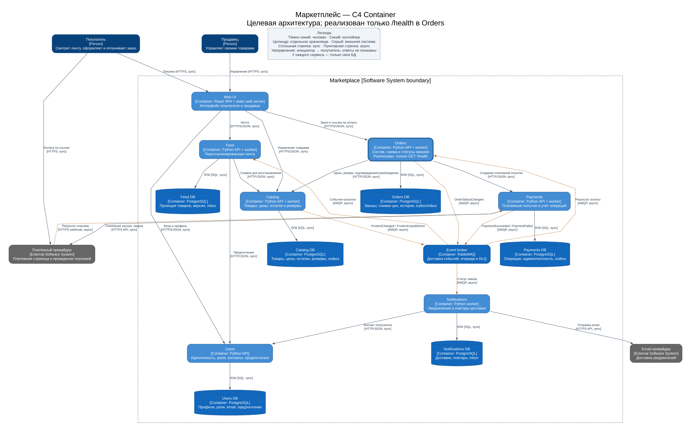

# ДЗ 1. Архитектура маркетплейса

Маркетплейс разделён на шесть сервисов: пользователи, каталог, лента, заказы, платежи и уведомления.

**Реализован только сервис Orders с `GET /health`. Бизнес-логики нет.** Все остальные сервисы, базы, брокер, интеграции и потоки ниже — проект будущей системы; Docker Compose запускает только Orders. Health-check проверяет, что HTTP-сервер работает.

## 1. Контекст и допущения

Покупатель просматривает персональную ленту и оформляет заказы. Продавец управляет своими товарами. Один пользователь может иметь обе роли. Внешний платёжный провайдер проводит денежные операции, внешний провайдер уведомлений доставляет email.

Для первой версии предполагаются одна валюта (RUB), фиксированная цена товара и отсутствие доставки, скидок и возвратов в рамках задания. Один заказ может содержать товары разных продавцов, но имеет один платёж покупателя; выплаты продавцам вынесены за рамки кейса. Каталог отвечает также за доступный остаток и его резервирование. Эти операции только спроектированы.

Персонализация простая: покупатель задаёт любимые категории в профиле. Feed поднимает товары этих категорий выше остальных, внутри группы сортирует по времени публикации. Для гостя и пользователя без предпочтений выдаются новые доступные товары. Машинное обучение и сбор истории просмотров не нужны.

## 2. C4 Container



[Открыть диаграмму отдельно](docs/container.svg) · [Редактируемый исходник Graphviz](docs/container.dot)

Это уровень **Container**: показаны люди, граница системы, отдельно развёртываемые приложения, хранилища и внешние системы. Container в C4 — приложение или хранилище, а не обязательно Docker-контейнер. Каждое приложение подписано именем, технологией и назначением. Сплошные стрелки обозначают синхронные обращения, пунктирные — асинхронные сообщения. Стрелки обозначают инициатора вызова или направление сообщения; ответы отдельно не нарисованы.

Принятый стек проекта: Web UI — React SPA; шесть API/worker-сервисов — Python; отдельный PostgreSQL для каждого сервиса; RabbitMQ для событий. Выбор Python позволяет показать инфраструктурный каркас на стандартной библиотеке. Конкретные веб-фреймворки будущих сервисов здесь не фиксируются. Web UI раздаётся статическим веб-сервером; вызовы из браузера направляются на публичные HTTPS API сервисов. Настройка HTTPS относится к будущему развёртыванию.

Диаграмму можно пересобрать установленным Graphviz:

```bash
cd dz1
dot -Tsvg docs/container.dot -o docs/container.svg
```

## 3. Домены, сервисы и владение данными

Один домен соответствует одному сервису. У сервисов отдельные БД и учётные данные: сервисы не читают чужие таблицы и получают данные через API или события. Например, Notifications получает email покупателя через API Users, а не читает Users DB. Копии товаров в Feed нужны для выдачи ленты, а снимки цен в Orders сохраняют условия покупки.

| Домен / сервис | Ответственность | Собственные данные | Почему такая граница |
| --- | --- | --- | --- |
| Пользователи / Users | Учётные записи, аутентификация, роли покупателя/продавца, профиль и предпочтения | Users DB: пользователи, хеши паролей, роли, email, выбранные категории | Единая идентичность для покупателей и продавцов, без дублирования профилей |
| Каталог / Catalog | Создание и изменение товаров, цены, публикация, остатки и резервы; проверка принадлежности товара продавцу | Catalog DB: товары, категории, seller_id, текущие цены, остатки и резервы | Цена и доступность проверяются у одного владельца при оформлении |
| Лента / Feed | Сортировка и выдача товаров с учётом любимых категорий | Feed DB: копия опубликованных товаров для ленты, версия последнего события на товар | Чтение ленты масштабируется отдельно от записи каталога; исходные данные остаются в Catalog |
| Заказы / Orders | Создание заказа, снимок состава, итоговая сумма, переходы статуса и координация оформления | Orders DB: buyer_id, позиции и seller_id, снимки названий и цен, количество, сумма, reservation_id, статус и история | Изменение каталога не меняет уже оформленный заказ |
| Платежи / Payments | Платёжные попытки, учёт денежных операций, интеграция с провайдером и сверка статуса | Payments DB: order_id, сумма/валюта, ключи идемпотентности, идентификаторы провайдера, журнал и статусы операций | Повторные запросы и финансовый учёт изолированы от жизненного цикла заказа; карточные данные не хранятся |
| Уведомления / Notifications | Подготовка и отправка уведомлений о статусах заказов, повторы доставки | Notifications DB: event_id, канал, шаблон, статус доставки, число попыток, ID сообщения провайдера | Сбой email не блокирует заказ или оплату; email берётся у Users и не хранится как отдельный профиль |

Web UI — интерфейс к доменам, не владелец бизнес-данных. RabbitMQ хранит сообщения до доставки, но не является источником истины для заказов или платежей. Финансовый итог заказа рассчитывает Orders по ценам из Catalog; Payments получает зафиксированную сумму и учитывает оплату. Денежные суммы передаются целыми числами в копейках с кодом валюты.

## 4. Взаимодействия

Все вызовы в этом разделе — проектируемые контракты, кроме реализованного `/health`.

| Инициатор → получатель | Способ | Назначение |
| --- | --- | --- |
| Покупатель/продавец → Web UI | Синхронно, HTTPS | Работа с интерфейсом |
| Web UI → Users | Синхронно, HTTPS/JSON | Вход, профиль, роли и предпочтения |
| Web UI → Catalog | Синхронно, HTTPS/JSON | Управление товарами продавца |
| Web UI → Feed | Синхронно, HTTPS/JSON | Получение ленты |
| Web UI → Orders | Синхронно, HTTPS/JSON | Оформление и чтение заказа, получение ссылки на оплату |
| Feed → Users | Синхронно, HTTP/JSON внутри сети | Получение предпочтений; при недоступности — неперсональная лента |
| Feed → Catalog | Синхронно, HTTP/JSON внутри сети | Постраничный снимок товаров для восстановления проекции |
| Orders → Catalog | Синхронно, HTTP/JSON | Проверка актуальной цены и атомарный резерв остатков по order_id; подтверждение/освобождение резерва |
| Orders → Payments | Синхронно, HTTP/JSON | Идемпотентное создание платёжной попытки для заказа; возврат ссылки на оплату |
| Payments → платёжный провайдер | Синхронно, HTTPS API | Создание платёжной сессии и сверка неопределённого результата |
| Платёжный провайдер → Payments | Асинхронно, HTTPS webhook | Итог платежа; проверка подписи и защита от повторов |
| Catalog → RabbitMQ → Feed | Асинхронно, AMQP | `ProductChanged`, `ProductUnpublished`: обновление проекции товаров |
| Payments → RabbitMQ → Orders | Асинхронно, AMQP | `PaymentSucceeded`, `PaymentFailed`: изменение статуса заказа |
| Orders → RabbitMQ → Notifications | Асинхронно, AMQP | `OrderStatusChanged`: уведомление покупателя |
| Notifications → Users | Синхронно, HTTP/JSON | Контакт получателя по buyer_id |
| Notifications → email-провайдер | Синхронно, HTTPS API | Передача сообщения на доставку |
| Каждый сервис → собственная БД | Синхронно, PostgreSQL protocol | Чтение/запись только собственных данных |

Пользователь переходит по ссылке на платёжную страницу провайдера, поэтому данные карты не проходят через маркетплейс. API проверяют подписанный токен Users локально; ключи верификации распространяются инфраструктурой. Catalog дополнительно проверяет seller_id, Orders — владельца заказа. Межсервисные обращения требуют сервисной аутентификации. В каркасе токены и проверки доступа не реализованы.

### Оформление заказа и сбои

1. Orders создаёт заказ и запрашивает у Catalog текущие цены и резерв товаров. Catalog либо резервирует все позиции, либо отказывает. При изменении цены покупатель должен подтвердить новую сумму. Orders сохраняет состав заказа и сумму в копейках.
2. Orders обращается к Payments за ссылкой на оплату. Повтор одного запроса имеет тот же уникальный ключ и не создаёт второй платёж. После ответа провайдера Payments сохраняет результат и отправляет событие через RabbitMQ.
3. При успешной оплате Orders подтверждает резерв и меняет статус заказа, при окончательном отказе — освобождает резерв. Если результат неизвестен, Payments уточняет его у провайдера; до этого резерв сохраняется. Недостаток такого решения: при долгом сбое товар остаётся зарезервированным.
4. Orders отправляет событие о новом статусе, Notifications получает email из Users и передаёт письмо провайдеру. Сбой отправки письма не отменяет заказ: отправку можно повторить.

При сетевом сбое сервис повторяет незавершённый шаг по сохранённому состоянию. Событие сохраняется в БД вместе с изменением данных и затем отправляется в брокер — так оно не потеряется при перезапуске. Получатели запоминают ID обработанных событий, чтобы повторная доставка не меняла результат. Версия товара позволяет Feed игнорировать устаревшие изменения.

Лента обновляется с задержкой, поэтому перед покупкой цена и остаток повторно проверяются в Catalog. Для первоначального заполнения и восстановления своей копии Feed запрашивает товары у Catalog. Общей транзакции между БД сервисов нет — это основной недостаток выбранного разбиения.

Это описание будущего поведения. По условию ДЗ реализован только `/health`.

## 5. Варианты декомпозиции и trade-off’ы

### Вариант A: модульный монолит

Одно серверное приложение с шестью внутренними модулями и одной PostgreSQL; таблицами владеют модули, обращения идут через их интерфейсы. Web UI и внешние провайдеры остаются отдельными. Общая БД здесь принадлежит одному приложению, а не разделяется несколькими сервисами.

**Плюсы:** одно развёртывание и простой локальный запуск; заказ и резерв можно менять одной транзакцией; меньше сетевых отказов, внутренним вызовам не нужен брокер сообщений. Это практичный выбор для маленькой команды и неизвестной нагрузки.

**Минусы:** всплеск запросов ленты требует масштабировать всё приложение; ошибка или выпуск каталога затрагивает тот же процесс, что платежи; границы таблиц держатся на дисциплине команды. Выделение платежей позднее потребует переноса данных и замены локальных транзакций распределённым процессом.

### Вариант B: шесть доменных сервисов — выбран

Users, Catalog, Feed, Orders, Payments и Notifications развёртываются отдельно, каждый владеет своей БД. Синхронные API используются там, где ответ нужен немедленно, события — для распространения изменений и побочных действий.

**Плюсы:** Feed можно масштабировать отдельно от Catalog; сбой email не останавливает оформление; платёжный журнал и доступ к провайдеру изолированы; разные домены можно выпускать независимо. Владение данными закрепляется не только кодом, но и доступом к БД.

**Минусы:** шесть приложений, шесть БД и брокер сложнее сопровождать; оформление включает сетевые вызовы и восстановление после частичного успеха; нужно хранить неотправленные события, защищаться от повторов и отслеживать ошибки между сервисами; лента и уведомления согласованы с задержкой. Для небольшой команды это дороже монолита и не даёт автоматического выигрыша в скорости разработки.

### Почему выбран B

В рамках учебного кейса важны явные границы владения данными и взаимодействия сервисов. У ленты преобладает чтение, у каталога — изменение продавцами, у платежей — надёжный финансовый учёт, у уведомлений — допускающая задержку доставка. Эти различия дают конкретные основания для независимых границ и масштабирования. Заказы координируют оформление, но не владеют товарами, профилями и платёжным журналом.

Нагрузка и размер команды не заданы, поэтому утверждать, что микросервисы всегда лучше, нельзя: для реального раннего запуска маленькой командой вариант A был бы дешевле. Здесь сознательно выбран B для демонстрации сервисной декомпозиции; цена выбора — распределённая согласованность и больше инфраструктуры. Ограничение ДЗ соблюдается: целевая архитектура описана полностью, а реализован один минимальный сервис без бизнес-функциональности.

## 6. Запуск и проверка

Нужны Docker Engine / Docker Desktop и Docker Compose v2. Локальные Python, PostgreSQL и RabbitMQ для запуска в Docker не нужны. Первая сборка скачивает базовый образ Python.

Из корня репозитория:

```bash
cd dz1
docker compose up --build -d --wait
docker compose ps
curl -i http://localhost:8080/health
```

Ожидаемый ответ (служебные заголовки могут отличаться):

```http
HTTP/1.0 200 OK
Content-Type: application/json

{"status":"ok"}
```

У контейнера должен быть статус `healthy`: Docker сам вызывает `/health`. Процесс внутри слушает `0.0.0.0:8080`, наружу порт опубликован только на localhost. Контейнер работает от непривилегированного пользователя и не требует записи в файловую систему.

Если порт 8080 занят:

```bash
ORDERS_PORT=18080 docker compose up --build -d --wait
curl -i http://localhost:18080/health
```

Логи и остановка (из `dz1`):

```bash
docker compose logs orders
docker compose down
```

Необязательный запуск без Docker, с Python 3.12:

```bash
python3 services/orders/app.py
```

Кроме `GET /health`, GET-запросы возвращают `404`. Доменных HTTP endpoint’ов нет. Проверка контейнера и отрицательного маршрута описана в [протоколе проверки](docs/verification.md).

## 7. Соответствие критериям

| Критерий | Где смотреть |
| --- | --- |
| 1. C4 Container | Раздел 2, `docs/container.svg` и `docs/container.dot` |
| 2. Docker и 200 OK | Раздел 6, `services/orders/`, `docker-compose.yml`, протокол проверки |
| 3. Домены и ответственность | Раздел 3 |
| 4. Распределение доменов | Раздел 3, колонка с обоснованием границ |
| 5. Владение данными и взаимодействия | Разделы 3–4 и C4 |
| 6. Минимум два варианта | Раздел 5: монолит и доменные сервисы |
| 7. Trade-off’ы | Плюсы и минусы обоих вариантов в разделе 5 |
| 8. Финальный выбор | «Почему выбран B» в разделе 5 |
